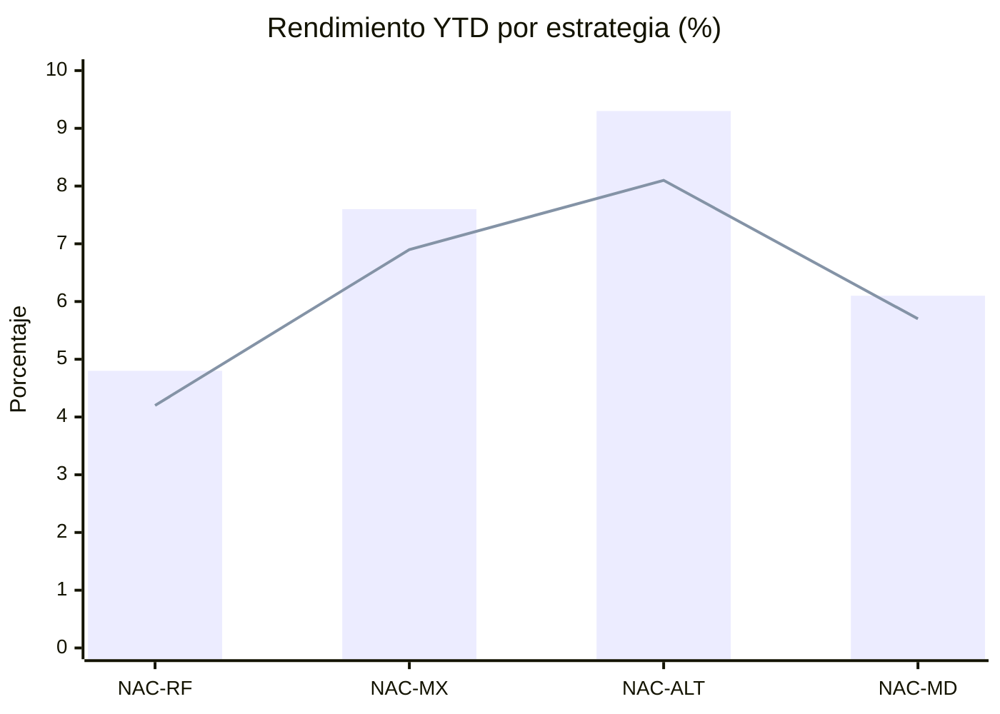
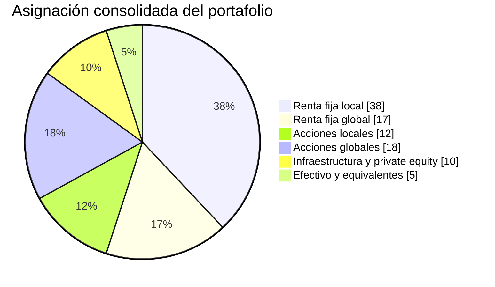
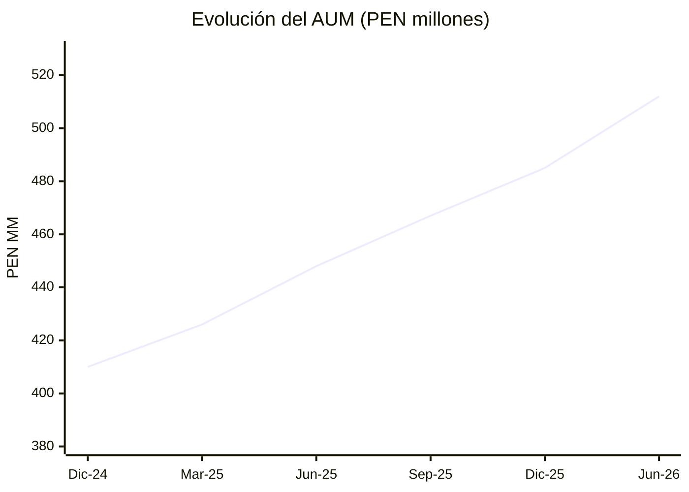

# Nexo Andino Capital S.A.C.

## Reporte de portafolio y desempeño - Primer semestre de 2026

**Código documental:** NAC-INV-006  
**Fecha de corte:** 30 de junio de 2026  
**Moneda:** millones de PEN, salvo indicación distinta  
**Patrimonio administrado consolidado:** **PEN 512,0 millones**

## 1. Resumen por estrategia

| Código | Estrategia | AUM (PEN MM) | Participación | Rendimiento YTD | Benchmark YTD | Volatilidad anualizada | Riesgo |
|---|---|---:|---:|---:|---:|---:|---|
| NAC-RF | Fondo Horizonte Renta Fija | 220,0 | 43,0% | 4,8% | 4,2% | 2,1% | Bajo-moderado |
| NAC-MX | Fondo Vector Mixto | 165,0 | 32,2% | 7,6% | 6,9% | 6,4% | Moderado |
| NAC-ALT | Fondo Cumbre Alternativos | 92,0 | 18,0% | 9,3% | 8,1% | 8,7% | Alto |
| NAC-MD | Mandatos Discrecionales | 35,0 | 6,8% | 6,1% | 5,7% | 4,8% | Moderado |
| **Total** |  | **512,0** | **100,0%** | **6,6% ponderado** | **5,9% ponderado** |  |  |

## 2. Rendimiento comparado

**Lectura:** las barras representan el rendimiento de cada estrategia y la línea representa su
benchmark. Las cuatro estrategias superaron su referencia durante el período.

## 3. Asignación consolidada por clase de activo

| Clase de activo | Participación | Valor (PEN MM) | Principal finalidad |
|---|---:|---:|---|
| Renta fija local | 38% | 194,56 | Ingreso, estabilidad y liquidez |
| Renta fija global | 17% | 87,04 | Diversificación de tasas y monedas |
| Acciones locales | 12% | 61,44 | Crecimiento vinculado al mercado doméstico |
| Acciones globales | 18% | 92,16 | Crecimiento y diversificación geográfica |
| Infraestructura y private equity | 10% | 51,20 | Prima de iliquidez y retorno de largo plazo |
| Efectivo y equivalentes | 5% | 25,60 | Rescates, oportunidades y garantías |
| **Total** | **100%** | **512,00** |  |

## 4. Evolución del patrimonio administrado

| Fecha | AUM (PEN MM) | Variación desde el período previo |
|---|---:|---:|
| 31/12/2024 | 410,0 | - |
| 31/03/2025 | 426,0 | 3,9% |
| 30/06/2025 | 448,0 | 5,2% |
| 30/09/2025 | 467,0 | 4,2% |
| 31/12/2025 | 485,0 | 3,9% |
| 30/06/2026 | 512,0 | 5,6% |

## 5. Atribución resumida del rendimiento

- **NAC-RF:** contribución positiva de bonos corporativos de alta calidad y duración corta.
- **NAC-MX:** principal aporte de acciones globales y reducción táctica de duración.
- **NAC-ALT:** valorización de infraestructura logística y distribución de un fondo de deuda privada.
- **NAC-MD:** resultados heterogéneos; la mediana de los mandatos fue 6,0%.
