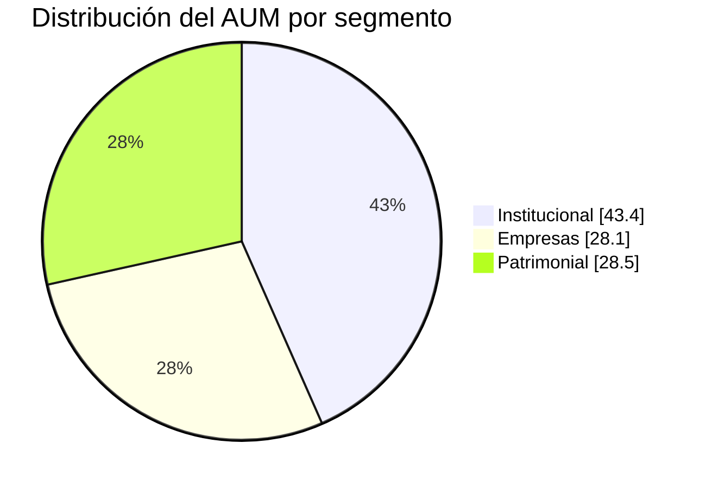
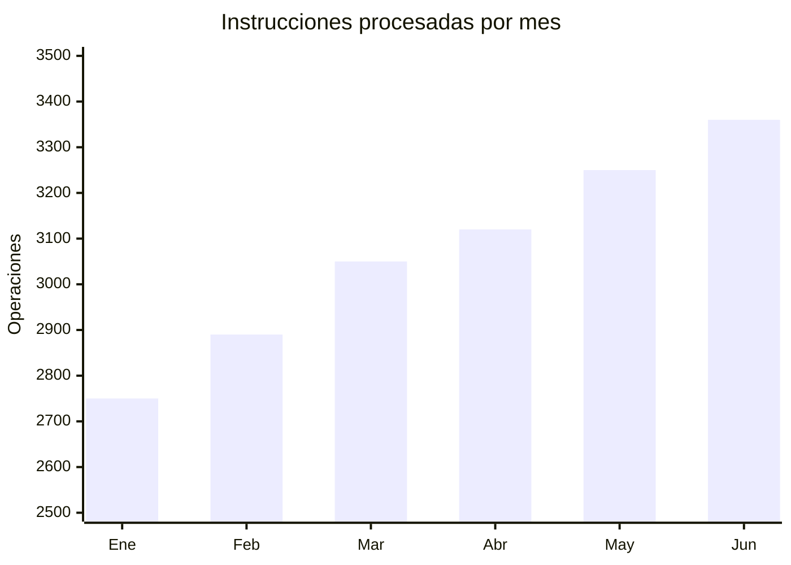
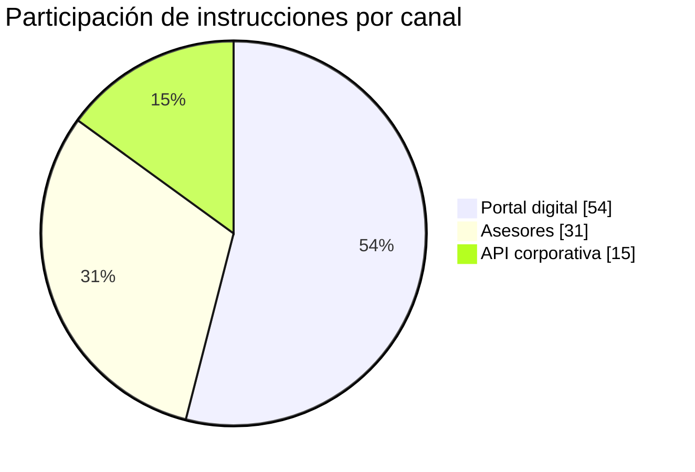

# Nexo Andino Capital S.A.C.

## Reporte comercial, clientes y operaciones - Primer semestre de 2026

**Código documental:** NAC-COM-008  
**Fecha de corte:** 30 de junio de 2026  
**Moneda:** millones de PEN, salvo indicación distinta

## 1. Segmentación de clientes

| Segmento | Clientes activos | AUM (PEN MM) | Participación del AUM | AUM promedio por cliente (PEN MM) |
|---|---:|---:|---:|---:|
| Institucional | 86 | 222,0 | 43,4% | 2,581 |
| Empresas | 248 | 144,0 | 28,1% | 0,581 |
| Patrimonial | 914 | 146,0 | 28,5% | 0,160 |
| **Total** | **1.248** | **512,0** | **100,0%** | **0,410** |

## 2. Actividad operativa mensual

| Mes | Instrucciones procesadas | Monto movilizado (PEN MM) | Procesamiento automático | Tasa de fallas |
|---|---:|---:|---:|---:|
| Enero | 2.750 | 142,0 | 92,0% | 0,8% |
| Febrero | 2.890 | 149,0 | 92,1% | 0,8% |
| Marzo | 3.050 | 158,0 | 92,3% | 0,7% |
| Abril | 3.120 | 164,0 | 92,5% | 0,7% |
| Mayo | 3.250 | 171,0 | 92,6% | 0,6% |
| Junio | 3.360 | 179,0 | 92,9% | 0,6% |
| **Total / promedio** | **18.420** | **963,0** | **92,4%** | **0,7%** |

## 3. Mezcla de canales

| Canal | Participación | Uso predominante |
|---|---:|---|
| Portal digital | 54% | Suscripciones, rescates y estados de cuenta |
| Asesores | 31% | Mandatos, perfilamiento y operaciones asistidas |
| API corporativa | 15% | Flujos institucionales y tesorerías empresariales |
| **Total** | **100%** |  |

## 4. Indicadores de servicio y crecimiento

| Indicador | H1 2025 | H1 2026 | Variación |
|---|---:|---:|---:|
| Clientes activos | 1.082 | 1.248 | 15,3% |
| Altas netas de clientes | 126 | 166 | 31,7% |
| NPS | 39 | 46 | +7 puntos |
| Reclamos por cada 1.000 operaciones | 2,9 | 2,1 | -27,6% |
| Disponibilidad del portal | 99,72% | 99,86% | +0,14 pp |
| Tiempo mediano de validación automática | 6,2 min | 4,6 min | -25,8% |

## 5. Concentración comercial

Los diez principales clientes representan 18,6% del AUM. El mayor cliente individual representa
3,1% del patrimonio administrado. El segmento institucional genera 43,4% del AUM, pero solo 6,9%
del número de clientes, por lo que sus controles de continuidad y servicio tienen prioridad alta.

## 6. Criterios de medición

- La tasa de procesamiento automático de 92,4% se calcula sobre 18.420 instrucciones.
- Las operaciones rechazadas por KYC vencido no se contabilizan como procesadas.
- La disponibilidad del portal excluye mantenimientos programados comunicados con 48 horas de anticipación.
